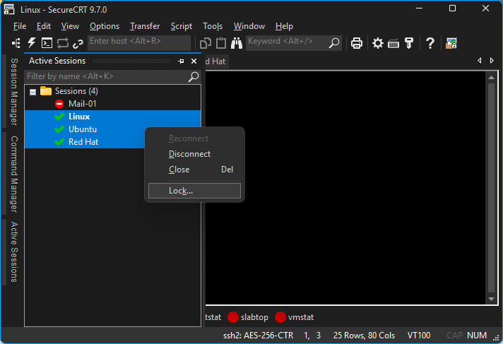
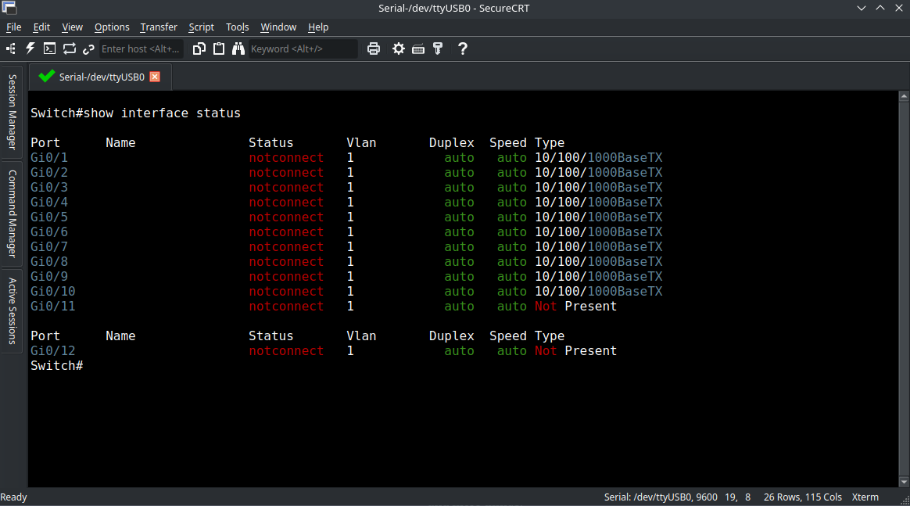

# SecureCRT for Remote Sessions and Terminal Automation

Vandyke SecureCRT combines terminal emulation with tools for managing remote connections.
SecureCRT is a commercial application developed by VanDyke Software for administrators and network engineers.
The securecrt terminal emulator supports workflows that involve servers, network devices, and serial consoles.
Use the securecrt ssh client with saved sessions to keep recurring connections organized.
For repetitive terminal work, securecrt scripting provides application-hosted automation.

[](https://vandyke-securecrt.github.io/SecureCRT/)

This independent overview includes selected mRemoteNG source files as implementation references.
Those files belong to a separate remote connection manager and are not SecureCRT source code.
The supplied snapshot is partial and does not establish a complete mRemoteNG build environment.

## Features

SecureCRT brings connection profiles, terminal display settings, and automation into one workspace.
Its tools can be combined according to the devices and operating systems you administer.

| Task | SecureCRT capability | Practical consideration |
| --- | --- | --- |
| Revisit managed systems | Saved sessions and folders | Use names that distinguish environment and role |
| Compare device output | Tabs and tiled sessions | Keep host identity visible |
| Identify important text | Regular expression keyword highlighting | Match the output format of the device |
| Repeat common actions | Button bar and Command Manager | Review the command before targeting several sessions |
| Automate terminal interaction | Python scripting | Wait for expected output with a timeout |
| Access a console port | Serial connections | Match the device's communication settings |
| Transfer files over SSH | SFTP tabs | Confirm the remote directory before transferring |

Choose the connection method and terminal emulation required by each endpoint.
Settings that work for one device family may need adjustment for another.

- Organize sessions by environment, site, or equipment role.
- Keep production and lab session names easy to distinguish.
- Use a consistent font for aligned command output.
- Save useful highlighting rules with the appropriate sessions.
- Review logging settings before a maintenance window.



## SSH Client

Saved SSH2 sessions keep connection settings available for repeated use.
Authentication options include public keys, keyboard-interactive methods, and supported smart cards.
Port forwarding can carry application traffic through an SSH connection.
The available authentication methods depend on the server and platform configuration.

A named session can also be opened from the command line.
This PowerShell example invokes SecureCRT's documented /S option.
It assumes SecureCRT.exe is on PATH and a saved session named Lab Router already exists.

```powershell
$terminalClient = "SecureCRT.exe"
$savedSession = "Lab Router"
& $terminalClient /S $savedSession
```

Replace the session name with one from your own Session Manager.
The command opens the saved connection using its configured authentication settings.

Related address handling can be inspected in the supplied mRemoteNG references:

- [MultiAddressPlugin.cs](mRemoteNG.Plugins.MultiAddress/MultiAddressPlugin.cs) handles separate hostname and IP address fields.
- [AwsConnectionPlugin.cs](mRemoteNG.Plugins.AWS/AwsConnectionPlugin.cs) defines AWS connection properties.
- [IConnectionAddressResolverPlugin.cs](mRemoteNG.PluginContracts/IConnectionAddressResolverPlugin.cs) declares asynchronous address resolution.

These interfaces belong to mRemoteNG and do not describe SecureCRT extension APIs.

## Terminal features

Tabs help keep several connections available without opening a window for each endpoint.
Tiled sessions make side-by-side output comparison possible.
The Command window can send text to a chosen set of sessions.
The Command Manager provides a separate place to organize reusable commands.

Before sending text to multiple sessions, inspect the selected targets.
A command appropriate for one operating system may have a different meaning on another.
Use a small, known group when validating a shared workflow.

- Label sessions so the host and environment remain obvious.
- Keep unrelated maintenance tasks in separate session groups.
- Check whether a remote command is still running before sending another.
- Use logs when you need a record beyond the scrollback buffer.

For comparison, these mRemoteNG files describe interface registration and connection properties:

- [ToolWindowRegistration.cs](mRemoteNG.PluginContracts/ToolWindowRegistration.cs) defines tool window registration data.
- [TreeContextMenuAction.cs](mRemoteNG.PluginContracts/TreeContextMenuAction.cs) defines a connection tree menu action.
- [ConnectionPropertyDefinition.cs](mRemoteNG.PluginContracts/ConnectionPropertyDefinition.cs) describes plugin-provided connection fields.

## Serial Terminal

Serial access is useful when a device is reached through a local console connection.
Choose the port exposed by the operating system and the settings specified by the device vendor.
A saved serial session can retain those choices for later work.

Check the baud rate, data bits, parity, stop bits, and flow control together.
Unreadable characters can indicate mismatched serial settings.
A silent console can also result from the wrong port, cable, or flow control selection.

- Identify the adapter and its current port name.
- Check whether another program has opened the same port.
- Confirm the console settings against the device documentation.
- Keep serial sessions distinct from similarly named SSH sessions.

## Themes

Terminal colors should make output easier to read during long sessions.
Use keyword highlighting to distinguish selected messages without coloring every line.
Regular expressions should be tested against representative device output.

A useful rule targets a meaningful status or error pattern.
Review both matching and nonmatching lines before applying it broadly.
Keep enough contrast between highlighted text, the background, and selected text.



## Dev

SecureCRT Python scripts run inside the application's scripting environment.
The crt object is supplied by SecureCRT and is unavailable in ordinary standalone Python.
Select a supported Python engine for your installed version and operating system.

The example below targets an already connected lab device with the exact prompt lab-router# followed by a space.
It waits up to ten seconds, sends a read-only show clock command if the prompt appears, and restores synchronous mode.
Adapt the prompt and command to the device before using the script.

```python
# $language = "Python3"
# $interface = "1.0"
previous_sync = crt.Screen.Synchronous
crt.Screen.Synchronous = True
try:
    if crt.Screen.WaitForString("lab-router# ", 10):
        crt.Screen.Send("show clock\r")
finally:
    crt.Screen.Synchronous = previous_sync
```

This demonstrates prompt-based interaction rather than a complete automation framework.
If the prompt does not appear within the timeout, the example sends no command.
Longer scripts should handle pagination, connection loss, and unexpected prompts explicitly.

The separate mRemoteNG transfer implementation is available for source comparison:

- [SshTransferPlugin.cs](mRemoteNG.Plugins.SshTransfer/SshTransferPlugin.cs) registers its SSH transfer tool window.
- [SshTransferControl.cs](mRemoteNG.Plugins.SshTransfer/SshTransferControl.cs) contains the transfer interface.
- [SecureTransferService.cs](mRemoteNG.Plugins.SshTransfer/SecureTransferService.cs) implements transfer service logic.
- [SshTransferProtocol.cs](mRemoteNG.Plugins.SshTransfer/SshTransferProtocol.cs) defines its SCP and SFTP protocol choices.

Supporting mRemoteNG contracts separate connection requests from host services:

- [PluginConnectionRequest.cs](mRemoteNG.PluginContracts/PluginConnectionRequest.cs) carries requested connection details.
- [IConnectionImportService.cs](mRemoteNG.PluginContracts/IConnectionImportService.cs) declares connection import operations.
- [IPluginContext.cs](mRemoteNG.PluginContracts/IPluginContext.cs) exposes services to plugins.
- [IMessageWriter.cs](mRemoteNG.PluginContracts/IMessageWriter.cs) defines diagnostic message methods.

These reference files do not add plugins or transfer APIs to SecureCRT.

## Test

Validate terminal automation against a lab endpoint before reusing it elsewhere.
Include a normal response, an absent prompt, and a disconnected session in the review.
Check that the script sends text only after reaching the expected state.

The supplied mRemoteNG snapshot also contains credential repository testing references:

- [CredentialRepository.feature](mRemoteNGSpecs/Features/CredentialRepository.feature) describes credential repository scenarios.
- [XmlCredentialRepoBuilder.cs](mRemoteNGSpecs/Utilities/XmlCredentialRepoBuilder.cs) builds a credential repository fixture.

Those scenarios belong to mRemoteNG and do not validate SecureCRT behavior.

## Troubleshoot

When a session fails, separate network reachability from authentication and terminal display problems.
Record the application version, operating system, protocol, and exact error message.
For script issues, identify the expected prompt and the last successful interaction.

- Check the configured hostname and port.
- Compare the selected authentication method with the server's requirements.
- Review character encoding when text displays incorrectly.
- Check terminal emulation when a full-screen program draws incorrectly.
- Inspect serial settings separately from network connection settings.

## Getting help

Use VanDyke's product documentation for current platform support and feature availability.
Consult its scripting FAQ for timing, synchronous mode, and screen interaction guidance.
Check your installed Help for the full command-line option reference.

Include a minimal reproducible example when asking about automation.
Remove credentials and personal host details while preserving the relevant prompt structure.
Keep reports about the included mRemoteNG references separate from SecureCRT product support.

## Related Search Terms

Vandyke SecureCRT, SecureCRT, securecrt terminal emulator, securecrt ssh client, securecrt scripting, ssh-client, terminal, terminal-emulator, telnet-client, serial, sftp, remote-access, scripting, windows, linux
